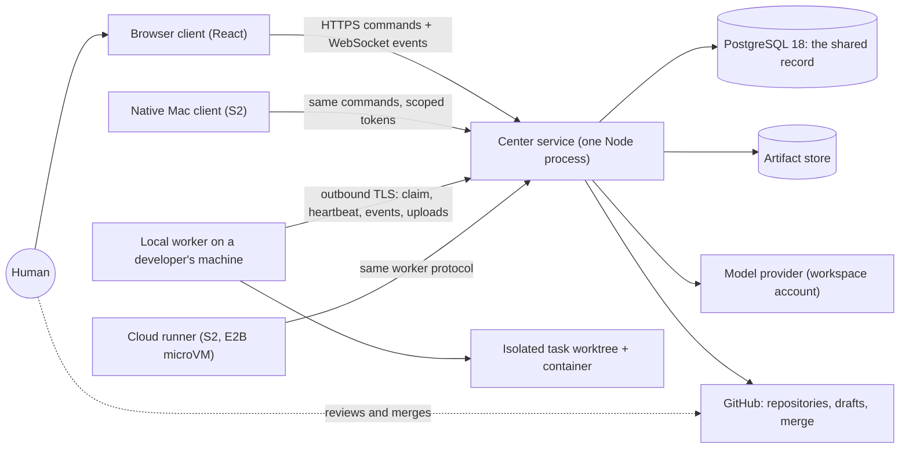
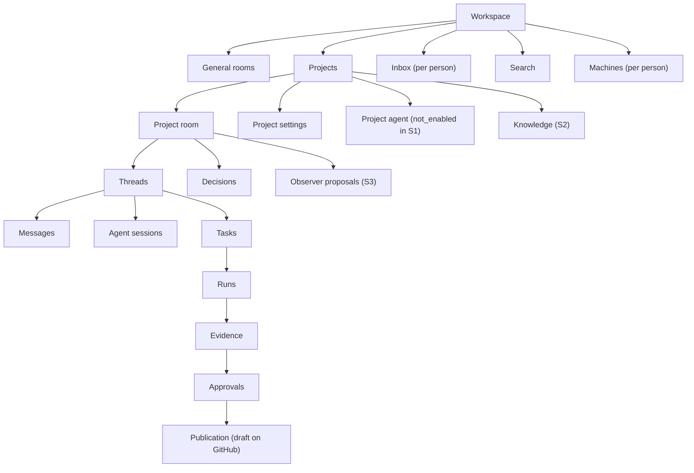
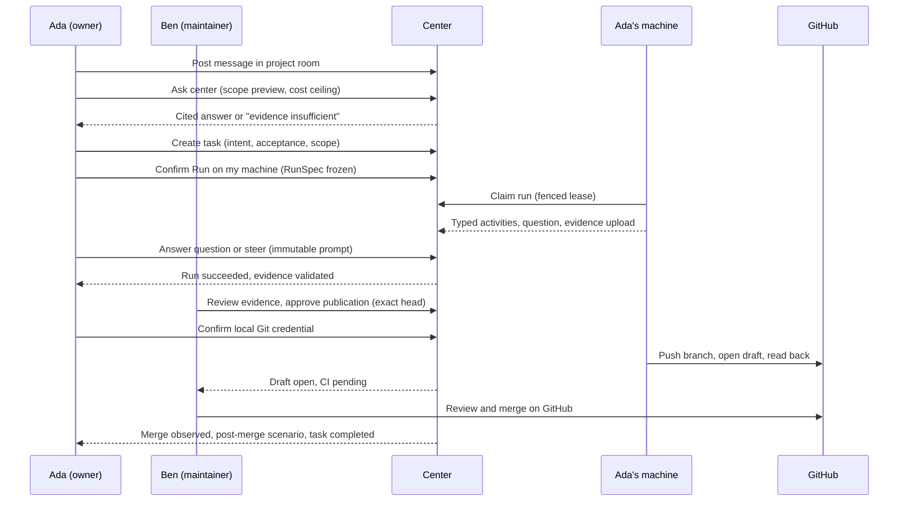
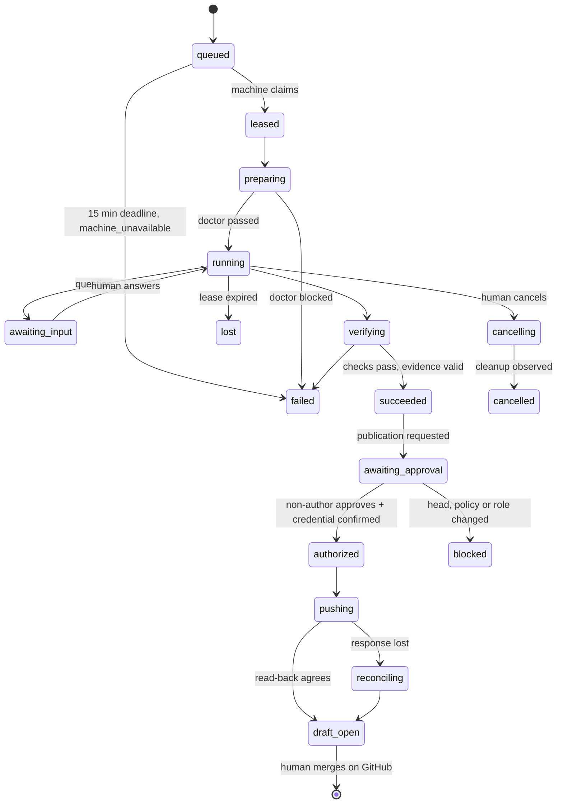
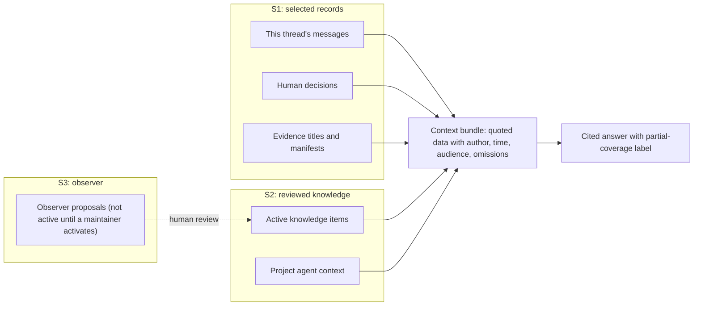
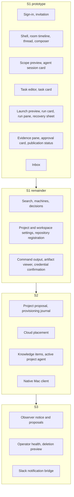

# Visual maps

Six Mermaid diagrams. Each is written so it reads in source form. Sources: spec [R03](../technical-spec.md#r03-architecture-and-component-ownership), [R06](../technical-spec.md#r06-state-machines-and-invariants), [R07](../technical-spec.md#r07-ordered-api-event-and-retry-contracts), [R13](../technical-spec.md#r13-durable-decisions-knowledge-and-observer-lifecycle), and the [implementation plan](../implementation-plan.md).

## System map

Who talks to whom. Only the center service holds durable state. Workers connect outbound and hold no database access.

## Information architecture

What sits where in the shell and how records relate. Stage labels mark later-stage areas.

## Conversation to work journey

The primary story, from a message to a merged change, with every human authority point named.

## Run, evidence and publication lifecycle

Run states from R06, then the publication states that follow a succeeded run. Every terminal state is final; a retry is a new run.

## Memory scopes

What the center may read when answering, and what is added in later stages. Nothing here grants authority; memory advises.

## Release-stage surface map

Which surfaces belong to which stage. Design the S1 prototype set first.

