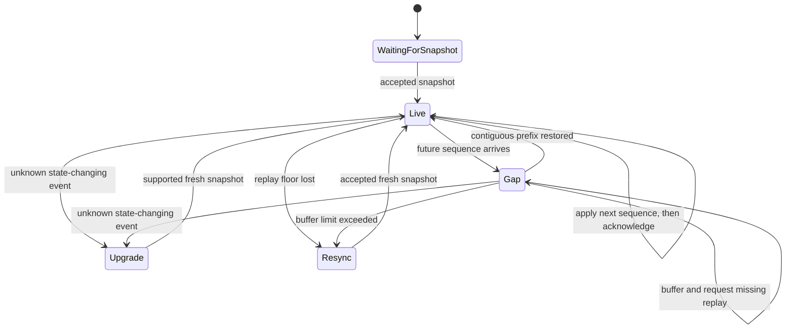

# Client synchronization

## What and why

Agora's client core is a framework-independent state machine. It turns validated, transport-neutral inputs into deeply immutable snapshots and explicit replay, acknowledgement and command decisions. A renderer reads these snapshots; a socket, HTTP cache or UI framework must not maintain a competing timeline.

Separating synchronization from rendering lets browser and future native clients share the same protocol rules without importing service, storage or provider internals. The current TypeScript core consumes generated neutral contract values. An independent Swift fixture consumer checks the same literal replay outcomes.

## How it works



| Input or state | Core behavior |
| --- | --- |
| Snapshot | Accept state and cursor together for one stream, without moving backwards or replacing a newer known record revision. Request replay strictly after the accepted cursor. |
| Ordered event | Apply the next contiguous sequence. Compare decimal revisions without floating-point conversion. Acknowledge only the applied prefix. |
| Duplicate | Suppress by stream and sequence. Do not create another message, unread position or acknowledgement. Streams have no global order. |
| Gap | Buffer up to 1,000 out-of-order entries and request replay. Overflow or replay-floor loss requests a new snapshot; missing events are never invented. |
| Unknown state change | Preserve the projection and cursor, request upgrade, and pause further event application. Synchronization mode changes, not authoritative record data. |
| Command receipt | Settle the known command without advancing any timeline cursor. Reusing an ID with a changed request digest is a conflict. |
| Retry | Retry only the same idempotent Agora command ID and digest. Wait offline or for a rate-limit interval, refresh stale state, and stop on denial. No provider-call retry or offline privileged queue exists here. |
| Unread | Keep an explicit, monotone `last_seen_room_seq`. Count visible message positions created after it, not sequence distance. Edits, tombstones and run-card events do not add unread positions. Delivery does not mark reading. |
| Draft | Keep text visibly `unsent` through route and snapshot changes. Logout or revocation input clears private state. Browser session-storage integration is a later adapter responsibility. |

## Current implementation status

Implemented for namespaced, non-production foundation fixtures. The public core API is `initialState` and `synchronize` from `@agora/client-core`; `scripts/client-fixture.ts` validates and translates fixture values outside that package. The core neither exports fixture types nor knows fixture event names. There is no React UI, browser transport, production conversation schema, authentication or service route in this feature.

Package export maps, dependency lint, public-type traversal and a no-DOM/no-Node compilation lane enforce the boundaries. Private adapters may use their SDK internally, but SDK and DOM types cannot become public ports. The center's Hono factory remains private; its existing public HTTP fixture is unchanged. This work does not qualify the U01a milestone or the full foundation gate.

## Verify it

```sh
pnpm client:replay -- --json --swift
pnpm boundaries
pnpm check
```

The first command compares six literal TypeScript and Swift snapshots and records each TypeScript transition. The boundary command writes `.scratch/boundaries.json` and injects forbidden import forms, transitive public-type leaks, private-path imports and ambient browser types, including controlled disabled-guard cases. Neither command needs a browser.

Exact subjects, assertions, performance samples and cleanup are retained in the [contract-slice evidence](../../evidence/U01a/agora-s1-isolate-client-core/1-contracts/review.md), [core and lane-7 evidence](../../evidence/U01a/agora-s1-isolate-client-core/2-core/review.md), and [boundary and lane-8 evidence](../../evidence/U01a/agora-s1-isolate-client-core/3-boundaries/review.md). See the [development runbook](../runbooks/development.md) for package contracts and the [technical specification](../technical-spec.md#r07-ordered-api-event-and-retry-contracts) for protocol authority.
