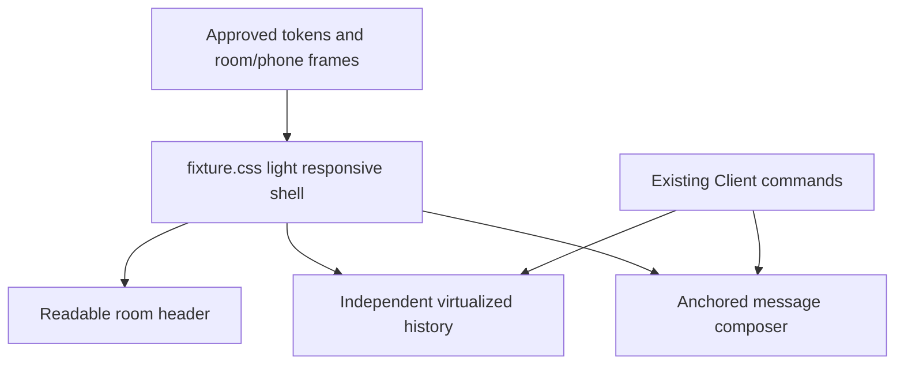

# Local room web shell

## What it is

A reusable React room shell under `apps/web`, built over `@agora/web-framework` and `@agora/client-core`. The framework owns the one-writer Client, named hooks and a typed `EnvironmentPort`. The application owns the browser Host adapter, development fixture transport and shell components. The development fixture is in-memory; the live local route uses the L1-L3 runtime for persisted messages. No hosted room, authentication or production conversation schema exists yet.

## What it does

`App`, `Timeline` and `Composer` read immutable Client projections through named hooks and issue only named commands (`useSetDraft`, `useRoomCommands`). They never receive arbitrary event dispatch, mutable store internals or a factory for a second authoritative room store. Ephemeral presentation state (composer busy, deferred focus target, delayed announcement) stays local, using named portable framework hooks (`useDeferredFocus`, `useDelayedAnnouncement`) instead of raw React effects. Browser capabilities reach `App` and `Composer` only through `EnvironmentPort`: transport subscribe/send, focus scheduling, deferred timers, media-query subscription, clock and identifier access. `Timeline` virtualizes instead of paging (see [timeline virtualization](local-room-timeline-virtualization.md)); its raw effects and DOM globals live in the local `apps/web/src/framework/` owner, which — unlike the portable `@agora/web-framework` package — gets the same Host DOM exemption as `apps/web/src/host/environment.ts`. Message times are a display reading of the stored wire timestamp ([message times](local-room-time-display.md)), not a second ordering key.

## Why it exists

Product UI work must not wait on L3 transport or invent a second timeline inside component state. One live Client plus a narrow environment port lets the fixture transport stand in today and a real transport replace it later without rewriting shell components or their tests. The framework package stays free of `apps/*`, domain, storage and provider SDKs so boundaries stay mechanical.

## How it works

```flow
Host composition | main.tsx creates one RoomClient with FixtureTransport for the fixture; main-live.tsx creates the same shell over createLiveTransport and the local runtime. Both inject one Client and browser EnvironmentPort through AgoraProvider.
EnvironmentPort | Named capabilities only: transport, scheduleFocus, defer, media query, now, createId, digestText. No fetch, WebSocket, storage or raw window handle.
RoomClient | Forwards every input to client-core synchronize(); holds only frozen state and a bounded transcript.
Named hooks | useClientSelector, useSetDraft, useRoomCommands, useTransportState, useMediaQuery, useStaleSafeBusy, useDeferredFocus, useDelayedAnnouncement own subscribe/unsubscribe, stale completion rejection, timers and cleanup.
Room shell | Renders header, a virtualized timeline and composer/status; MessageRow re-commits only when its own message reference changes.
FixtureControls | Development-only; the sole importer of the concrete fixture transport beyond Host wiring.
```

## Implementation status

**In progress: browser shell, persisted live local transport and approved presentation are available; hosted persistence is not connected.** The shell runs against a validated development fixture or the L1-L3 local runtime, preserves keyboard, focus, composition Enter, phone/desktop viewport and update-isolation behavior, and uses the light surfaces, typography, restrained borders, rounded controls and narrow-screen spacing from the approved handoff. The responsive CSS keeps the header readable, the virtualized timeline independently scrollable and the composer anchored below it; no send/read command path changed. There is no production conversation schema or hosted room. Design references remain authoritative at `docs/design-handoff/results/`; the live shell is a bounded presentation adaptation, not a copy of the proposed full application.



[Live room UI](local-room.md#live-room-ui) tracks remaining connection, delivery and qualification gaps. `docs/technical-spec.md` AC02 remains unqualified.

## Verification and proof

Inspect the [framework barrel](repo:packages/web-framework/src/index.ts), [EnvironmentPort](repo:packages/web-framework/src/environment.ts), [RoomClient and hooks](repo:packages/web-framework/src/client.ts), [Host adapter](repo:apps/web/src/host/environment.ts), [fixture transport](repo:apps/web/src/host/fixture.ts) and [room shell](repo:apps/web/src/components/App.tsx). Behavioral coverage lives in [framework client tests](repo:packages/web-framework/test/client.test.ts), [framework boundary tests](repo:packages/web-framework/test/boundaries.test.ts), [fixture tests](repo:apps/web/test/fixture.test.ts) and [shell tests](repo:apps/web/test/app.test.tsx).

Run `pnpm web:test` for unit and component coverage, `pnpm web:dev` for the live fixture, and `pnpm web:build` for the production bundle. A build that exits 0 does not prove the bundle runs; [production build under strict CSP](#production-build-under-strict-csp) says what does. The root `pnpm test`/`pnpm check` gate runs these same `apps/web/test/**` files under the same jsdom + React environment (`vitest.config.ts`'s `projects` array points at `apps/web/vitest.config.ts` directly instead of re-declaring a Node-environment glob over them), so a contributor running only the root gate exercises this coverage too, not just `pnpm web:test` in isolation. The approved-shell check used the owned local runtime and chrome-devtools-axi at desktop and 390x844 phone widths: no horizontal overflow, message send/read rendered through the live client, and the browser console was clean. This is a visual smoke check, not final visual acceptance or an accessibility audit. The framework and host foundation landed in three earlier dependency-ordered units, with red/green and size evidence under [evidence/local-room/web-framework-foundation/](repo:evidence/local-room/web-framework-foundation/outcome.json), [evidence/local-room/web-framework-host/](repo:evidence/local-room/web-framework-host/outcome.json) and [evidence/local-room/web-framework-shell/](repo:evidence/local-room/web-framework-shell/outcome.json). `.agents/skills/verify-agora/SKILL.md` records the public browser driver checklist.

## Production build under strict CSP

The production build of the fixture room (`pnpm web:build`, entry `apps/web/src/main.tsx`) used to render a blank page. [`apps/web/src/host/fixture.ts`](repo:apps/web/src/host/fixture.ts) validates its fixture with `createWireValidator()` from `@agora/contracts`, and the Node implementation of that function calls `ajv.compile` at module load. Ajv generates source text for every schema it compiles and runs it through the `Function` constructor. The first such compile is the JSON Schema 2020-12 meta-schema that `addSchema` checks, before any wire schema, so compiling fewer schemas would not help. The build injects a Content-Security-Policy meta from [`apps/web/vite.config.ts`](repo:apps/web/vite.config.ts) with `script-src 'self'` and no `unsafe-eval`, so Chrome refuses the call, module evaluation throws an `EvalError`, and React never mounts. `pnpm web:dev` hid the defect because the dev server sends no policy. The served local room (`scripts/local-room-service.ts`) had already avoided the problem under [D92](repo:docs/decisions.tsv), but only for four local-room components and only inside that script.

The fix moves validator compilation to build time and keeps the policy byte for byte. [`contracts/tools/browser-validator.ts`](repo:contracts/tools/browser-validator.ts) exports `browserValidatorPlugin()`, a Vite plugin published as `@agora/contracts/browser-validator`. It resolves the exact specifier `@agora/contracts` to a virtual module. That module's `createWireValidator()` wraps Ajv standalone validators that `browserValidatorSource()` generates from the authored schemas while Vite builds. It covers every `$defs` component of every wire schema family, the same set the Node `createWireValidator()` compiles, under the same Ajv options. Node and browser map a validator's result to `{ ok, value }` or `{ ok: false, details }` through one function, `wireValidatorOf` in [`contracts/src/wire-validator.ts`](repo:contracts/src/wire-validator.ts), so the two cannot drift on result shape. `apps/web/vite.config.ts` applies the plugin to builds only. `scripts/local-room-service.ts` now uses the same plugin and no longer writes `validator.cjs`/`validator.mjs` into its runtime root.

```flow
Authored schemas | contracts/schemas/*.schema.json stay the only wire source. Nothing here edits generated output by hand.
Build time, in Node | During vite build, browserValidatorSource() runs Ajv standalone code generation over every $defs component and emits plain JavaScript validator functions.
Virtual module | The plugin answers the import @agora/contracts with a module whose createWireValidator() is wireValidatorOf over those functions. Subpath imports such as @agora/contracts/canonical resolve to their real files.
Run time, in the browser | The bundle contains validator functions and Ajv's small runtime helpers, not Ajv's compiler. Nothing calls eval or Function, so script-src 'self' never blocks it.
Result | The fixture is validated before the room renders. A schema-invalid fixture shows a Fixture rejected alert instead of a blank page.
```

The [before and after diagram](repo:docs/site/production-build-csp.svg) draws both paths side by side. The site publishes it as a source record; open the SVG from a checkout to see the drawing. The boundary is the dashed line in that drawing. Ajv's compiler and the schema files run only in Node during the build. The browser receives generated functions and never sees a schema it would have to compile. Validation stays on. The fixture room checks its fixture and the served room checks every wire value it reads, and neither policy gains `unsafe-eval`.

**In progress.** Code, regression test and browser proof are in this change; the [atlas](atlas.md) status of the web shell does not move until the change lands with its receipts and an independent review. The regression test is [`apps/web/test/built-room.test.ts`](repo:apps/web/test/built-room.test.ts). It builds `apps/web` with its real `vite.config.ts` into a unique `.scratch/` directory and asserts the built `index.html` carries the exact unchanged policy. It then loads the bundle into jsdom inside `node --disallow-code-generation-from-strings`, which refuses `eval` and `Function` the same way the policy does, and asserts the room renders from the validated fixture. A copy of the bundle with one fixture value corrupted must render `Fixture rejected: snapshot failed FixtureSyncSnapshot validation`. Run it with `pnpm web:test`. The browser recipe in [verify-agora](repo:.agents/skills/verify-agora/SKILL.md) builds, previews on an owned port and drives real Chrome at 1440x900 and 390x844 with a console check. Receipts live under `evidence/U01d/production-browser-csp/`. The [before-fix reproduction](repo:evidence/U01d/production-browser-csp/reproduction/README.md) separates trigger, mask and symptom. The [guard negatives](repo:evidence/U01d/production-browser-csp/guard-negatives.log) and the [fixed-build browser run](repo:evidence/U01d/production-browser-csp/browser/README.md), with screenshots, console and assertions, were rerun at the rebased fix head `1111c95`. The recorder's signed [red](repo:evidence/U01d/production-browser-csp/history/a9efaa6/red.log) and [green](repo:evidence/U01d/production-browser-csp/history/a9efaa6/green.log) runs name the pre-rebase head `a9efaa6`, so the evidence validator rejects them for this branch. The signed bundle for `1111c95` on `15619b1` needs the owner's producer key and is not recorded yet. The [decision trail](repo:docs/decisions.tsv) records the choice to extend D92 instead of relaxing the policy.

Next: [client synchronization](synchronization.md) and [system architecture](architecture.md).
