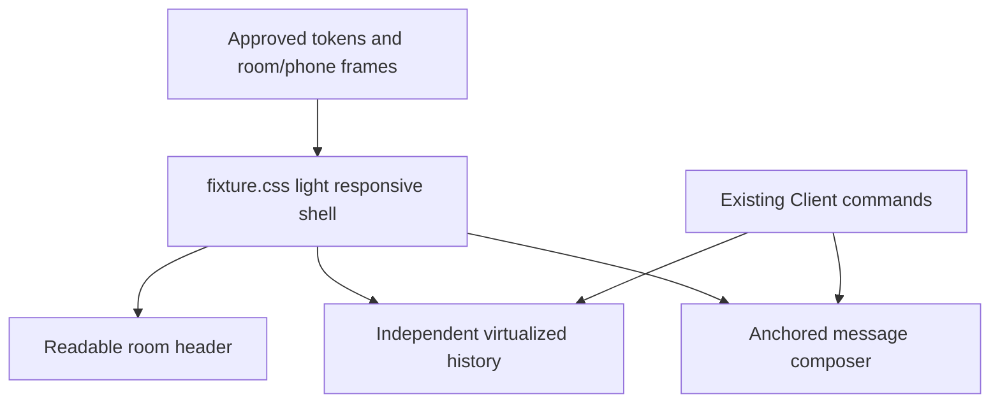

# Local room web shell

## What it is

A reusable React room shell under `apps/web`, built over `@agora/web-framework` and `@agora/client-core`. The framework owns the one-writer Client, named hooks and a typed `EnvironmentPort`. The application owns the browser Host adapter, development fixture transport and shell components. The development fixture is in-memory; the live local route uses the L1-L3 runtime for persisted messages. No hosted room, authentication or production conversation schema exists yet.

## What it does

`App`, `Timeline` and `Composer` read immutable Client projections through named hooks and issue only named commands (`useSetDraft`, `useRoomCommands`). They never receive arbitrary event dispatch, mutable store internals or a factory for a second authoritative room store. Ephemeral presentation state (composer busy, deferred focus target, delayed announcement) stays local, using named portable framework hooks (`useDeferredFocus`, `useDelayedAnnouncement`) instead of raw React effects. Browser capabilities reach `App` and `Composer` only through `EnvironmentPort`: transport subscribe/send, focus scheduling, deferred timers, media-query subscription, clock and identifier access. `Timeline` virtualizes instead of paging (see [timeline virtualization](local-room-timeline-virtualization.md)); its raw effects and DOM globals live in the local `apps/web/src/framework/` owner, which — unlike the portable `@agora/web-framework` package — gets the same Host DOM exemption as `apps/web/src/host/environment.ts`.

## Why it exists

Product UI work must not wait on L3 transport or invent a second timeline inside component state. One live Client plus a narrow environment port lets the fixture transport stand in today and a real transport replace it later without rewriting shell components or their tests. The framework package stays free of `apps/*`, domain, storage and provider SDKs so boundaries stay mechanical.

## How it works

```flow
Host composition | main.tsx creates one RoomClient with FixtureTransport for the fixture; main-live.tsx creates the same shell over createLiveTransport and the local runtime. Both inject one Client and browser EnvironmentPort through AgoraProvider.
EnvironmentPort | Named capabilities only: transport, scheduleFocus, defer, media query, now, createId, digestText. No fetch, WebSocket, storage or raw window handle.
RoomClient | Forwards every input to client-core synchronize(); holds only frozen state and a bounded transcript.
Named hooks | useClientSelector, useSetDraft, useRoomCommands, useTransportState, useMediaQuery, useStaleSafeBusy, useDeferredFocus, useDelayedAnnouncement own subscribe/unsubscribe, stale completion rejection, timers and cleanup.
Room shell | Renders header, a virtualized timeline and composer/status; MessageRow re-commits only when its own message reference changes.
FixtureControls | Development-only; the sole importer of the concrete fixture transport beyond Host wiring.
```

## Implementation status

**In progress: browser shell, persisted live local transport and approved presentation are available; hosted persistence is not connected.** The shell runs against a validated development fixture or the L1-L3 local runtime, preserves keyboard, focus, composition Enter, phone/desktop viewport and update-isolation behavior, and uses the light surfaces, typography, restrained borders, rounded controls and narrow-screen spacing from the approved handoff. The responsive CSS keeps the header readable, the virtualized timeline independently scrollable and the composer anchored below it; no send/read command path changed. There is no production conversation schema or hosted room. Design references remain authoritative at `docs/design-handoff/results/`; the live shell is a bounded presentation adaptation, not a copy of the proposed full application.



[Live room UI](local-room.md#live-room-ui) tracks remaining connection, delivery and qualification gaps. `docs/technical-spec.md` AC02 remains unqualified.

## Verification and proof

Inspect the [framework barrel](repo:packages/web-framework/src/index.ts), [EnvironmentPort](repo:packages/web-framework/src/environment.ts), [RoomClient and hooks](repo:packages/web-framework/src/client.ts), [Host adapter](repo:apps/web/src/host/environment.ts), [fixture transport](repo:apps/web/src/host/fixture.ts) and [room shell](repo:apps/web/src/components/App.tsx). Behavioral coverage lives in [framework client tests](repo:packages/web-framework/test/client.test.ts), [framework boundary tests](repo:packages/web-framework/test/boundaries.test.ts), [fixture tests](repo:apps/web/test/fixture.test.ts) and [shell tests](repo:apps/web/test/app.test.tsx).

Run `pnpm web:test` for unit and component coverage, `pnpm web:dev` for the live fixture, and `pnpm web:build` for the production bundle. The approved-shell check used the owned local runtime and chrome-devtools-axi at desktop and 390x844 phone widths: no horizontal overflow, message send/read rendered through the live client, and the browser console was clean. This is a visual smoke check, not final visual acceptance or an accessibility audit. The framework and host foundation landed in three earlier dependency-ordered units, with red/green and size evidence under [evidence/local-room/web-framework-foundation/](repo:evidence/local-room/web-framework-foundation/outcome.json), [evidence/local-room/web-framework-host/](repo:evidence/local-room/web-framework-host/outcome.json) and [evidence/local-room/web-framework-shell/](repo:evidence/local-room/web-framework-shell/outcome.json). `.agents/skills/verify-agora/SKILL.md` records the public browser driver checklist.

Next: [client synchronization](synchronization.md) and [system architecture](architecture.md).
