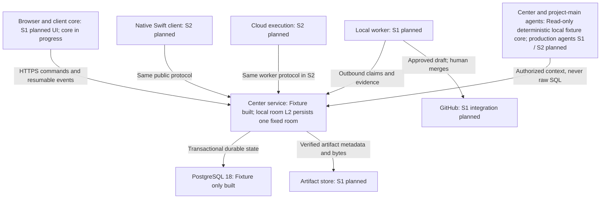
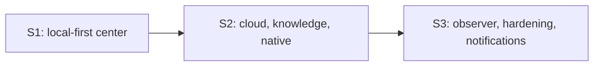

# Agora progress atlas

<!-- Generated by pnpm docs:atlas from docs/site/atlas.json. Do not edit. -->

As of 2026-09-23, revision `f4992158118d08de51a5019ddc7926fe9edeec88`. Build snapshot, not a live tracker.

1 of 28 milestones (U01a) is Built within its own declared scope; the full test-first foundation is not yet qualified, and no usable communication center exists at this snapshot.

## Legend

- Built: implemented within the cited scope.
- In progress: active but incomplete.
- Planned: specified for a release stage.
- Deferred: outside the current queue.
- Not started: milestone not begun.

## System map

- **Browser and client core**: Show shared conversation without owning authority. [Explanation](architecture.md)
- **Center service**: Validate commands; later own policy and ordered events. [Explanation](foundation.md)
- **PostgreSQL 18**: Commit scoped state and events together. [Explanation](foundation.md)
- **Artifact store**: Keep immutable proof bytes outside the database. [Explanation](memory.md)
- **Local worker**: Execute only on the consenting owner's machine. [Explanation](execution.md)
- **Cloud execution**: Run fresh microVM attempts using the same contract. [Explanation](execution.md)
- **GitHub**: Own repositories, independent review and human merge. [Explanation](execution.md)
- **Center and project-main agents**: Answer and propose within explicit audience boundaries. [Explanation](authorization.md)
- **Native Swift client**: Offer human workflows without worker authority. [Explanation](architecture.md)

## Landed and active

- **PostgreSQL socket ownership - Built**: P0c A ownership, B bounded wrapper lifecycle and C guard-negative qualification proved at the recorded head. [Scope](foundation.md). [scripts/postgres-socket.ts](../../scripts/postgres-socket.ts); [scripts/with-test-postgres.mjs](../../scripts/with-test-postgres.mjs); [packages/storage/src/migrate-cli.ts](../../packages/storage/src/migrate-cli.ts); [packages/storage/test/postgres-wrapper.test.ts](../../packages/storage/test/postgres-wrapper.test.ts); [evidence/ci/P0c/C/migrations.log](../../evidence/ci/P0c/C/migrations.log); [evidence/ci/P0c/B/outcome.json](../../evidence/ci/P0c/B/outcome.json); [evidence/ci/P0c/C/outcome.json](../../evidence/ci/P0c/C/outcome.json); [evidence/ci/P0c/C/guard.json](../../evidence/ci/P0c/C/guard.json); [evidence/ci/P0c/C/scenarios.json](../../evidence/ci/P0c/C/scenarios.json); [evidence/ci/P0c/C/red.log](../../evidence/ci/P0c/C/red.log); [evidence/ci/P0c/C/green.log](../../evidence/ci/P0c/C/green.log)
- **Design-negative sandbox closure - In progress**: P0a widened the disposable fixture to match every path the decision trail cites; standalone design negatives are not yet wired into the pnpm check aggregate. [Scope](ci.md). [scripts/test-design-checks.mjs](../../scripts/test-design-checks.mjs); [evidence/ci/P0a/red.log](../../evidence/ci/P0a/red.log); [evidence/ci/P0a/green.log](../../evidence/ci/P0a/green.log)
- **Toolchain and native readiness - In progress**: P0b doctor implemented, review pending; mandatory CI, PostgreSQL hardening, React guards and hosted enforcement remain unimplemented. [Scope](ci.md). [scripts/ci-doctor.mjs](../../scripts/ci-doctor.mjs); [scripts/test/ci-doctor.test.ts](../../scripts/test/ci-doctor.test.ts); [evidence/ci/P0b/green.log](../../evidence/ci/P0b/green.log)
- **Mandatory local checks - In progress**: A landing on local main needs a passing receipt for that exact commit; the hook is active only after install, and the Firstmate landing tool still has to call verify. [Scope](local-checks.md). [scripts/local-checks.mjs](../../scripts/local-checks.mjs); [scripts/test/local-checks.test.ts](../../scripts/test/local-checks.test.ts); [agora/local-checks.json](../../agora/local-checks.json)
- **Owned project verification - In progress**: Drive real isolated fixtures and retain proof without touching another attempt. [Scope](project-controls.md). [packages/verification/test/project.test.ts](../../packages/verification/test/project.test.ts); [evidence/U01b/agora-s1-isolate-development/assertion-red.log](../../evidence/U01b/agora-s1-isolate-development/assertion-red.log)
- **Trusted checks - In progress**: Only the project's own reporting App, on the exact head and with a signed receipt, can satisfy a required check; live protection and App setup are blocked on human prerequisites. [Scope](trusted-checks.md). [scripts/trusted-checks.mjs](../../scripts/trusted-checks.mjs); [scripts/trusted-report.mjs](../../scripts/trusted-report.mjs); [packages/verification/test/trusted-checks.test.ts](../../packages/verification/test/trusted-checks.test.ts); [packages/verification/test/trusted-report.test.ts](../../packages/verification/test/trusted-report.test.ts); [agora/trusted-checks.json](../../agora/trusted-checks.json)
- **Task proof admission - Built**: Reject missing or forged proof before a task can claim readiness. [Scope](test-first.md). [contracts/src/index.ts](../../contracts/src/index.ts); [packages/verification/test/admission.test.ts](../../packages/verification/test/admission.test.ts); [packages/verification/test/protocol.test.ts](../../packages/verification/test/protocol.test.ts); [evidence/U01a/agora-s1-enforce-test-first/task-report.json](../../evidence/U01a/agora-s1-enforce-test-first/task-report.json)
- **Repository foundation - Built**: Prove real decisions and database isolation before product authority exists. [Scope](foundation.md). [apps/center/src/app.ts](../../apps/center/src/app.ts); [packages/storage/src/fixture.ts](../../packages/storage/src/fixture.ts); [apps/center/test/policy.test.ts](../../apps/center/test/policy.test.ts); [packages/storage/test/fixture.pg.test.ts](../../packages/storage/test/fixture.pg.test.ts); [evidence/U01a/agora-s1-bootstrap-repository/outcome.json](../../evidence/U01a/agora-s1-bootstrap-repository/outcome.json)
- **Portable wire contracts - Built**: Make the same bytes mean the same thing in TypeScript and Swift. [Scope](contracts.md). [contracts/src/conformance.ts](../../contracts/src/conformance.ts); [contracts/test/conformance.test.ts](../../contracts/test/conformance.test.ts); [evidence/U01a/agora-s1-publish-portable-contracts/outcome.json](../../evidence/U01a/agora-s1-publish-portable-contracts/outcome.json)
- **Client synchronization isolation - Built**: Keep replay, ordering and retry decisions independent of the renderer. [Scope](synchronization.md). [packages/client-core/src/index.ts](../../packages/client-core/src/index.ts); [packages/client-core/test/sync.test.ts](../../packages/client-core/test/sync.test.ts); [packages/client-core/test/boundaries.test.ts](../../packages/client-core/test/boundaries.test.ts); [evidence/U01a/agora-s1-isolate-client-core/2-core/green.log](../../evidence/U01a/agora-s1-isolate-client-core/2-core/green.log)
- **Local room - In progress**: Owned local runtime, persistent messages and cursor replay, landed on main with L1, L2 and CI P0a-P0c, plus an independently testable L5 deterministic local-answer core and selected-message posting: browser or CLI triggers a committed, cited local-agent quote, not model inference. Browser retries persist an action command ID through lost response and clear it after receipt; cross-tab action races and full L5 qualification remain open. L4's first slice has landed: the apps/web room shell runs over a live Host transport, two tabs converge on committed history, a repeated Send keeps one identity and permanent rejections stop. Own sends no longer count as unread, the status announcement repeats the header's unread total, and phone buttons are 44 px. Remaining L4: real connection state with manual disconnect and read cancellation, per-command delivery states, session drafts, browser receipt-failure proof, measurements and a VoiceOver pass. [Scope](local-room.md). [contracts/schemas/local-room.schema.json](../../contracts/schemas/local-room.schema.json); [packages/domain/src/local-room/port.ts](../../packages/domain/src/local-room/port.ts); [packages/storage/src/local-room.ts](../../packages/storage/src/local-room.ts); [packages/storage/drizzle/0001_local_room.sql](../../packages/storage/drizzle/0001_local_room.sql); [apps/center/test/local-room.pg.test.ts](../../apps/center/test/local-room.pg.test.ts); [packages/storage/test/local-room.pg.test.ts](../../packages/storage/test/local-room.pg.test.ts); [evidence/local-room/persistence/outcome.json](../../evidence/local-room/persistence/outcome.json); [scripts/local-room.ts](../../scripts/local-room.ts); [scripts/local-room-client.ts](../../scripts/local-room-client.ts); [apps/center/test/runtime.pg.test.ts](../../apps/center/test/runtime.pg.test.ts); [apps/center/test/runtime.test.ts](../../apps/center/test/runtime.test.ts); [evidence/local-room/runtime/outcome.json](../../evidence/local-room/runtime/outcome.json); [packages/domain/src/local-answer/proposal.ts](../../packages/domain/src/local-answer/proposal.ts); [packages/domain/test/local-answer.test.ts](../../packages/domain/test/local-answer.test.ts); [packages/domain/test/local-answer-guards.test.ts](../../packages/domain/test/local-answer-guards.test.ts); [evidence/local-room/agent-core/outcome.json](../../evidence/local-room/agent-core/outcome.json); [apps/center/test/local-answer.pg.test.ts](../../apps/center/test/local-answer.pg.test.ts); [evidence/local-room/agent-response/two-tab.png](../../evidence/local-room/agent-response/two-tab.png); [evidence/local-room/agent-response/red-green/green.log](../../evidence/local-room/agent-response/red-green/green.log); [apps/web/src/host/live.ts](../../apps/web/src/host/live.ts); [apps/web/test/live.test.ts](../../apps/web/test/live.test.ts); [evidence/local-room/web-live/correction/outcome.json](../../evidence/local-room/web-live/correction/outcome.json); [evidence/local-room/usability-fixes/README.md](../../evidence/local-room/usability-fixes/README.md)
- **Living documentation and progress atlas - In progress**: Make the system explain itself as each verified part lands. [Scope](authoring.md). [docs/implementation-plan.md](../../docs/implementation-plan.md)
- **Application architecture boundaries - Built**: Make Feature/Client/Host and renderer shortcuts fail in lint and tests with owner-named diagnostics (B1 import ownership + B2a exact-row exception registry + B2b foot-guns). [Scope](app-architecture.md). [apps/web/src/reserved-owners.ts](../../apps/web/src/reserved-owners.ts); [scripts/boundary-policy.ts](../../scripts/boundary-policy.ts); [scripts/architecture-exceptions.ts](../../scripts/architecture-exceptions.ts); [agora/architecture-exceptions.json](../../agora/architecture-exceptions.json); [scripts/renderer-policy.ts](../../scripts/renderer-policy.ts); [packages/client-core/test/app-architecture.test.ts](../../packages/client-core/test/app-architecture.test.ts); [evidence/U20/agora-s1-lint-application-architecture/outcome.json](../../evidence/U20/agora-s1-lint-application-architecture/outcome.json); [evidence/U20/agora-s1-lint-application-architecture/whole-feature-red.log](../../evidence/U20/agora-s1-lint-application-architecture/whole-feature-red.log); [evidence/U20/agora-s1-lint-application-architecture/green.log](../../evidence/U20/agora-s1-lint-application-architecture/green.log); [evidence/U20/agora-s1-lint-application-architecture/b2a-exceptions/outcome.json](../../evidence/U20/agora-s1-lint-application-architecture/b2a-exceptions/outcome.json); [evidence/U20/agora-s1-lint-application-architecture/b2a-exceptions/red.log](../../evidence/U20/agora-s1-lint-application-architecture/b2a-exceptions/red.log); [evidence/U20/agora-s1-lint-application-architecture/b2a-exceptions/green.log](../../evidence/U20/agora-s1-lint-application-architecture/b2a-exceptions/green.log); [evidence/U20/agora-s1-lint-application-architecture/b2b-renderer/outcome.json](../../evidence/U20/agora-s1-lint-application-architecture/b2b-renderer/outcome.json); [evidence/U20/agora-s1-lint-application-architecture/b2b-renderer/red.log](../../evidence/U20/agora-s1-lint-application-architecture/b2b-renderer/red.log); [evidence/U20/agora-s1-lint-application-architecture/b2b-renderer/green.log](../../evidence/U20/agora-s1-lint-application-architecture/b2b-renderer/green.log)
- **Local room web shell - In progress**: Give the browser one writer Client and typed EnvironmentPort, with the live room now styled to the approved light tokens and responsive shell while remaining in progress pending broader L4 qualification. [Scope](local-room-web-shell.md). [packages/web-framework/src/client.ts](../../packages/web-framework/src/client.ts); [packages/web-framework/src/environment.ts](../../packages/web-framework/src/environment.ts); [apps/web/src/host/environment.ts](../../apps/web/src/host/environment.ts); [apps/web/src/components/App.tsx](../../apps/web/src/components/App.tsx); [apps/web/test/app.test.tsx](../../apps/web/test/app.test.tsx); [packages/web-framework/test/boundaries.test.ts](../../packages/web-framework/test/boundaries.test.ts); [evidence/local-room/web-framework-foundation/outcome.json](../../evidence/local-room/web-framework-foundation/outcome.json); [evidence/local-room/web-framework-host/outcome.json](../../evidence/local-room/web-framework-host/outcome.json); [evidence/local-room/web-framework-shell/outcome.json](../../evidence/local-room/web-framework-shell/outcome.json)
- **Timeline virtualization - In progress**: Salvaged from a preserved source copy's Pretext/react-virtual implementation and integrated onto the current consolidated App.tsx behind the local apps/web/src/framework owner, so 50,000-message rooms mount only visible rows. [Scope](local-room-timeline-virtualization.md). [apps/web/src/framework/useTimelineVirtualizer.ts](../../apps/web/src/framework/useTimelineVirtualizer.ts); [apps/web/src/components/Timeline.tsx](../../apps/web/src/components/Timeline.tsx); [apps/web/src/rows.ts](../../apps/web/src/rows.ts); [apps/web/test/app.test.tsx](../../apps/web/test/app.test.tsx); [evidence/local-room/virtualization/salvage-inventory.md](../../evidence/local-room/virtualization/salvage-inventory.md)
- **Message times - In progress**: Show a locale-aware reading of the stored wire created_at, keep that value available for inspection, and leave committed-sequence order unchanged. [Scope](local-room-time-display.md). [apps/web/src/host/message-time.ts](../../apps/web/src/host/message-time.ts); [apps/web/src/components/Timeline.tsx](../../apps/web/src/components/Timeline.tsx); [apps/web/test/message-time.test.ts](../../apps/web/test/message-time.test.ts); [evidence/local-room/time-display/phone-390x844.png](../../evidence/local-room/time-display/phone-390x844.png); [evidence/local-room/time-display/desktop-1440x900.png](../../evidence/local-room/time-display/desktop-1440x900.png); [evidence/local-room/time-display/README.md](../../evidence/local-room/time-display/README.md)
- **Agora application architecture - Planned**: Give every product Feature an owned folder, discovered rather than registered, behind a one-writer Client and a typed Host; U20 boundary lint is already Built and tracked separately as app-architecture, U21-U23 (discovery, Client/Host, migration) remain planned. [Scope](agora-application-architecture.md). [docs/technical-spec.md](../../docs/technical-spec.md); [docs/research-basis.md](../../docs/research-basis.md)

## Release roadmap

### S1

- **U01a - Built**: An engineer can build a small contract fixture, observe a real red/green test, reject a forbidden import, and compile the same wire values in TypeScript and Swift.
- **U01b - In progress**: An engineer drives both real applications through their CLIs and cannot obtain a passing trusted result from forged or missing proof.
- **U01c - Not started**: An operator restores the foundation on a separate host, proves its data and fences the old instance.
- **U01d - Not started**: A user navigates a large room and failure/recovery cards in a responsive accessible client without authority confusion.
- **U20 - In progress**: A renderer file that imports a storage or domain type, calls a browser global directly, or uses an unmediated effect fails lint with an error naming its supported owner.
- **U21 - Not started**: Adding a Feature with its reserved files makes it appear in the generated inventory automatically, and hand-editing that inventory instead of adding the reserved file fails the same way schema drift already fails.
- **U22 - Not started**: A component that holds durable timeline state in local state, or calls a browser global or transport directly, fails to build with an error naming the Client hook or Host method to use instead.
- **U23 - Not started**: The local-room feature's server entrypoint now lives in one discovered Feature folder, its generated inventory entry replaces the old hand-edited route registration, and every test that passed before the move still passes after it with an unchanged assertion.
- **U02 - Not started**: Two invited humans sign in and see only rooms they may read; an owner can revoke a member and see active access end.
- **U03 - Not started**: Two developers converse and search the same ordered history after reconnecting without duplicate messages or lost edits.
- **U04 - Not started**: A developer asks the center about a recorded decision and receives a cited answer without giving the agent execution or private-room authority.
- **U05 - Not started**: A human confirms one bounded task; fake competing workers cannot both own it, and expired authority stays unusable.
- **U06 - Not started**: The launching developer connects a worker without inbound ports and receives an isolated task worktree while their normal checkout stays unchanged.
- **U07 - Not started**: One real provider-backed task changes the fixture application, proves its user flow, and returns digest-verified evidence without host credential access.
- **U08 - Not started**: The second developer approves an exact result, the owner publishes a draft, and GitHub blocks merge until independent review and trusted current-head checks pass.
- **U09 - Not started**: Two developers complete the entire conversation-to-local-task-to-human-reviewed-result workflow and an operator can restore the center.

### S2

- **U10 - Not started**: An owner sees one repository and room with a truthful onboarding checkpoint; this milestone does not wait for future image/cloud units to activate the complete project.
- **U11 - Not started**: A maintainer builds an approved project environment and can reproduce it after deleting its cache.
- **U12 - Not started**: A human launches a cloud task in a fresh microVM and sees evidence and confirmed destruction, or a precise unresolved cleanup state.
- **U13 - Not started**: A project main agent answers after restart with cited approved decisions, and stale/disputed knowledge no longer enters operational context.
- **U14 - Not started**: A developer chooses local or cloud explicitly and receives the same trustworthy review contract, while placement-specific trust and cost remain visible.
- **U24 - Not started**: A maintainer proposes an agent from a room and a second eligible human confirms its exact plan before any spend; self-confirmation and confirmation without the preview are both rejected.
- **U18 - Not started**: A developer can use one qualified existing coding agent without granting it new authority.
- **U19 - Not started**: Two developers use a real native Mac client for the same human-governed workflow without acquiring local execution authority.

### S3

- **U15 - Not started**: A project conversation produces reviewable, attributed knowledge proposals without automatic truth or cross-project disclosure.
- **U16 - Not started**: An operator can recover the center and explain every retained, deleted, or unresolved resource without hidden authority.
- **U17 - Not started**: A requested Slack channel receives one approved notification linking to the authoritative Agora record, without becoming another control plane.
- **U25 - Not started**: A Bug Agent reproduces a seeded defect, posts one cited finding, a repeat of the same defect updates that finding instead of duplicating it, and a human-approved repair task closes through the ordinary independent-review path.

[Milestone authority](../implementation-plan.md). Status is owned only by `atlas.json`; the site and this companion are rendered from it.
